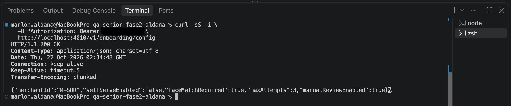
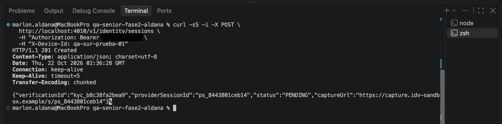
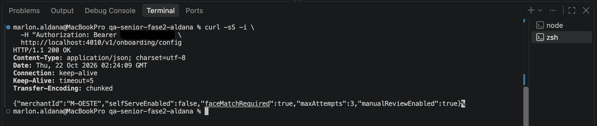
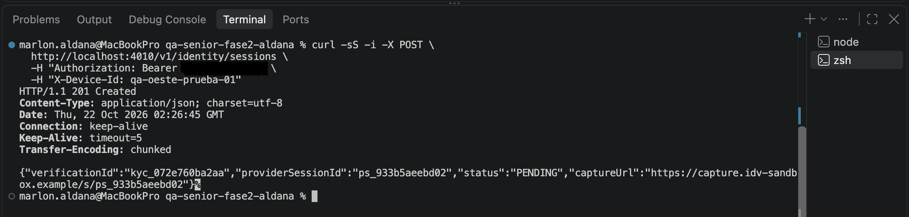

# BUG-01 — Se permite crear una sesión de verificación en un comercio deshabilitado

**Severidad:** Alta
**Prioridad:** P1
**Estado:** Abierto
**Referencia:** CA-01 / POST /v1/identity/sessions

## Descripción
El defecto se reprodujo en dos comercios con configuraciones diferentes: M-SUR, con el alta sin código desactivada, y M-OESTE, con un proveedor de identidad no soportado. En ambos casos, el servicio permitió crear una sesión cuando el contrato establece que debe rechazarla.

## Precondiciones
- Servicio QA disponible en localhost:4010.
- Comercio M-SUR con selfServeEnabled = false.
- Token de aplicación de M-SUR.
- Identificador de dispositivo de prueba nuevo.

## Pasos para reproducir
1. Consultar GET /v1/onboarding/config usando M-SUR.
2. Comprobar que selfServeEnabled es false.
3. Ejecutar POST /v1/identity/sessions con el mismo comercio y X-Device-Id.
4. Revisar el código HTTP y el cuerpo de respuesta.

## Resultado esperado
HTTP 409 con código MERCHANT_NOT_ENABLED.
No debe crearse una sesión de verificación.

## Resultado obtenido
HTTP 201 Created.
El backend devuelve verificationId, providerSessionId,
status PENDING y captureUrl.

## Justificación
Severidad alta porque permite iniciar un proceso de verificación
para un comercio que tiene deshabilitada la funcionalidad.

Prioridad P1 porque el control de habilitación del comercio
debe respetarse antes de permitir iniciar el proceso.

## Evidencia

### Escenario 1: M-SUR (funcionalidad desactivada)

**Configuración del comercio:**

**Sesión creada indebidamente:**

### Escenario 2: M-OESTE (proveedor no soportado)

**Configuración del comercio:**

**Sesión creada indebidamente:**

## Observación
Se confirmó la creación indebida de la sesión.
No se ha comprobado que el servicio permita completar el alta.