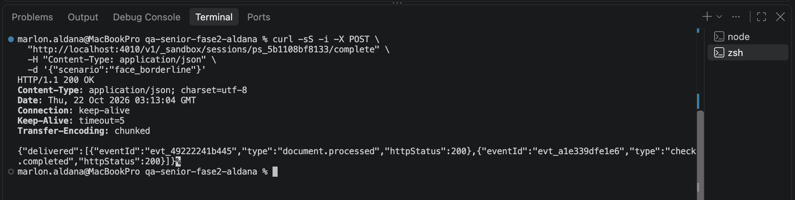
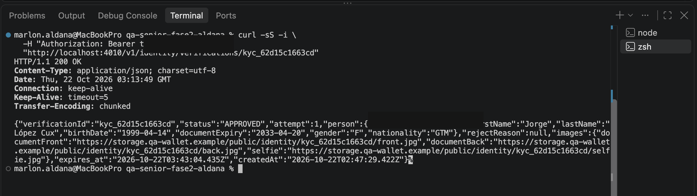
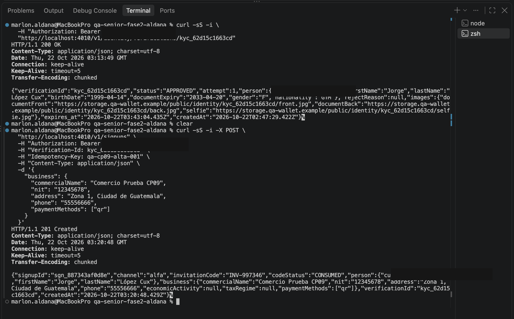

# BUG-02 — Se aprueba una verificación con puntaje facial inferior al mínimo permitido

**Severidad:** Crítica  
**Prioridad:** P1  
**Estado:** Abierto  
**Referencia:** CA-03 / POST /v1/webhooks/idv / GET /v1/identity/verifications/{id}

## Descripción

El backend aprueba una verificación de identidad con una coincidencia facial de 0.72, aunque el comercio M-NORTE exige un mínimo de 0.80.

El sistema está tomando como válida la aprobación del proveedor sin aplicar correctamente el umbral configurado por el comercio.

## Precondiciones

- Servicio QA disponible en localhost:4010.
- Comercio M-NORTE con coincidencia facial obligatoria.
- Umbral mínimo configurado en 0.80.
- Sesión de verificación nueva.
- Escenario del simulador: face_borderline.

## Pasos para reproducir

1. Crear una sesión mediante POST /v1/identity/sessions.
2. Obtener verificationId y providerSessionId.
3. Ejecutar el escenario face_borderline utilizando providerSessionId.
4. Confirmar que el simulador entregó los eventos.
5. Consultar GET /v1/identity/verifications/{id}.
6. Comparar el estado recibido con el comportamiento exigido por el contrato OpenAPI.

## Resultado esperado

La verificación debe quedar en estado REJECTED con motivo FACE_MISMATCH, debido a que el puntaje facial de 0.72 es inferior al mínimo requerido de 0.80.

El usuario debe poder realizar una nueva captura respetando el límite de intentos.

## Resultado obtenido

El backend devuelve APPROVED para una verificación con coincidencia facial de 0.72, aunque el mínimo del comercio es 0.80.

Posteriormente se ejecutó POST /v1/signups utilizando la misma verificación.

Resultado:
- HTTP 201 Created.
- Se generó un signupId.
- Se generó un código de invitación.
- El código quedó en estado CONSUMED.
- El alta quedó asociada a la verificación aprobada incorrectamente.

La creación ocurrió antes de vencer los 30 minutos de vigencia.

Se confirma que el control facial insuficiente no solo permite aprobar la identidad, sino también completar el alta.

## Justificación

**Severidad crítica:** Se incumple un control de verificación de identidad que puede permitir la aprobación de una persona sin alcanzar el nivel de coincidencia facial requerido.

**Prioridad P1:** Debe corregirse antes de liberar la funcionalidad por el riesgo de aprobar identidades que no cumplen las condiciones de seguridad del comercio.

## Evidencia

### Evidencia 1 — Simulación del proveedor

Se ejecutó el escenario face_borderline, que simula
una aprobación del proveedor con puntaje facial 0.72.
Los eventos fueron entregados con HTTP 200.

### Evidencia 2 — Verificación aprobada incorrectamente

Al consultar la verificación, el backend devolvió
APPROVED y rejectReason null, aunque el mínimo
del comercio es 0.80.

### Evidencia 3 — Creación indebida del alta

Se utilizó la misma verificación para ejecutar
POST /v1/signups.

El backend respondió HTTP 201 Created, generó el alta
y devolvió un código de invitación en estado CONSUMED.

## Observaciones

El defecto se confirmó tanto en la API como en SQLite: se persistió el alta `sgn_887343af0d8e` vinculada a `kyc_62d15c1663cd`, con `face_match_score=0.72`, umbral `0.80` y código `CONSUMED`. Ver `E6-datos/E6-resultados-consolidados.md`, apartado P01. La captura y el registro de BD corresponden a la misma prueba manual.